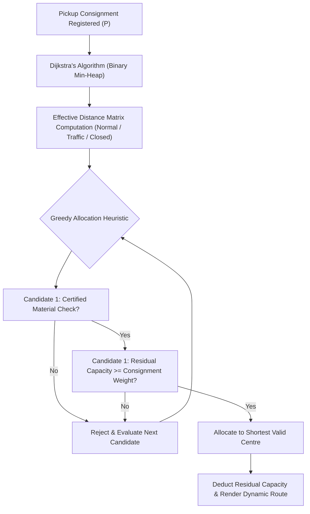

# EcoRoute — E-Waste Collection Route Optimisation Platform

<div align="center">

[](https://ecoroute-by-piyush.onrender.com)
[](https://react.dev/)
[](https://fastapi.tiangolo.com/)
[](https://leafletjs.com/)
[](LICENSE)

<br/>

**A production-ready geospatial logistics engine optimizing municipal electronic waste collection, dynamic traffic disruption mitigation, and capacity-constrained recycling dispatch across urban networks.**

[🌐 Explore Live App](https://ecoroute-by-piyush.onrender.com) • [🚀 Overview Page](https://ecoroute-by-piyush.onrender.com/) • [🗺️ Live Dispatch Simulator](https://ecoroute-by-piyush.onrender.com/dispatch) • [📊 Centres & Analytics](https://ecoroute-by-piyush.onrender.com/analytics) • [📑 Swagger API Docs](https://ecoroute-by-piyush.onrender.com/docs)

</div>

---

## 🌟 Quick Links & Live Deployments

| Component | Live Production URL | Description |
|---|---|---|
| **Live Web Application** | [ecoroute-by-piyush.onrender.com](https://ecoroute-by-piyush.onrender.com) | Unified full-stack web application hosted on Render |
| **Overview Page** | [ecoroute-by-piyush.onrender.com/](https://ecoroute-by-piyush.onrender.com/) | Platform landing dashboard, operational narrative & quick launch |
| **Live Dispatch Simulator** | [ecoroute-by-piyush.onrender.com/dispatch](https://ecoroute-by-piyush.onrender.com/dispatch) | Centerpiece interactive Leaflet optimizer, min-heap visualizer & disruption simulator |
| **Centres & Analytics** | [ecoroute-by-piyush.onrender.com/analytics](https://ecoroute-by-piyush.onrender.com/analytics) | Greedy vs. Global Optimal DFS benchmark & facility management |
| **Interactive REST API Docs** | [ecoroute-by-piyush.onrender.com/docs](https://ecoroute-by-piyush.onrender.com/docs) | FastAPI Swagger UI with full schema validation |

---

## 🖥️ Platform Showcase

### 1. Overview Page (`/`)

The **Overview Page** serves as the civic-logistics command center, welcoming operators and dispatch managers with an atmospheric UI, system telemetry status, and instant navigation into the routing engines.

<div align="center">
  
  <p><em>Figure 1: EcoRoute Overview Dashboard with branding, mission narrative, and quick-launch access.</em></p>
</div>

#### Key Features:
- **Atmospheric Civic UI:** Custom sunset/twilight horizon visual identity with clean typography and deep navy contrast.
- **Mission-Driven Workflow:** Direct high-visibility access to **Launch Simulator** and **View Analytics**.
- **System Telemetry Bar:** Global audio control engine (with sound effects), instant demo reset to default Delhi NCR topology, and Key Concepts educational drawer.
- **Responsive Layout:** Seamless scaling across mobile viewports, high-DPI tablets, and desktop workstations.

---

### 2. Live Dispatch Optimizer & Disruption Simulator (`/dispatch`)

The **Live Dispatch Simulator** is the interactive centerpiece of EcoRoute. It models urban Delhi NCR road networks, calculates shortest paths using binary min-heaps, and provides a full disruption sandbox with dynamic rerouting.

<div align="center">
  
  <p><em>Figure 2: Real-time Leaflet GIS canvas, Min-Heap priority queue strip, and Greedy Capacity-Constrained decision checklist.</em></p>
</div>

#### Key Features:
- **Interactive Geospatial Canvas:** Leaflet map running on CartoDB Positron light tiles with custom SVG `L.divIcon` pins for Pickups (`P1`–`P4`), Recycling Centres (`C1`–`C3`), and road intersections.
- **Real-Street Polylines:** Fetches real road geometry from OSRM with automatic straight-line fallback.
- **Dynamic Disruption Engine:** Click any road edge or distance pill to toggle:
  - 🟢 **Normal Conditions:** $1.0\times$ base travel impedance.
  - 🟡 **Heavy Traffic Congestion:** $2.5\times$ travel delay multiplier.
  - 🔴 **Arterial Roadblock:** Complete closure ($\infty$ cost) triggering real-time Dijkstra recalculation and vehicle rerouting.
- **Binary Min-Heap Visualizer:** Real-time priority queue strip displaying active node relaxations, tentative costs, and settled states.
- **Greedy Allocation Inspector:** Step-by-step evaluation of candidate facilities enforcing material certification matching and residual capacity verification.
- **Animated Vehicle Movement:** Real-time animated transport with heading-oriented vehicle rotation and dynamic facility capacity drops.
- **Playback Controls:** Play, pause, step forward/backward, speed multiplier ($0.5\times$, $1\times$, $2\times$), metric toggles (fastest travel time vs. shortest distance), and custom dispatch order sorting.

---

## ⚡ Core Algorithmic Architecture

EcoRoute combines two classic algorithms to deliver predictable, certified, and disruption-resilient dispatching:



### 1. Dijkstra’s Shortest Path Algorithm
- **Data Structure:** Python `heapq` binary min-heap achieving $O((V + E) \log V)$ time complexity.
- **Dynamic Impedance:**
  $$\text{Effective Weight} = \text{Base Distance} \times \text{Traffic Multiplier} \quad (\infty \text{ if closed})$$
- Computes all-pairs shortest paths between active pickups and certified recycling facilities.

### 2. Greedy Capacity-Constrained Allocation Heuristic
- Sorts pickup consignments by specified dispatch order (Default, Largest Weight First, Smallest First).
- Evaluates candidate recycling facilities by effective travel cost.
- Validates two critical operational constraints before assignment:
  1. **Certification Matching:** Facility accepted categories must include the consignment's e-waste stream.
  2. **Capacity Conservation:** Facility residual capacity must be strictly $\ge$ consignment weight.
- Decrements facility residual capacity immediately upon assignment.

### 3. Global Optimal Combinatorial Benchmark (Branch-and-Bound DFS)
- Evaluates all permutation allocations via pruned depth-first search.
- Computes mathematically optimal total network distance ($\text{km}$) and throughput ($\text{kg}$).
- Quantifies Greedy heuristic optimality gap (typically $< 3\%$) and execution speedup ($> 40\times$).

---

## ♻️ E-Waste Stream Categories

| Category | Accent Color | Hex Code | Typical Stream Materials |
|---|---|---|---|
| **Batteries** | Amber | `#D97706` | Lithium-ion cells, UPS lead-acid, automotive packs |
| **Computers** | Violet | `#7C3AED` | Desktops, laptops, server blades, high-density PCBs |
| **Smartphones** | Sky | `#0284C7` | Mobile phones, tablets, handheld wearables |
| **Appliances** | Teal | `#0D9488` | White goods, refrigerators, microwaves, AC compressors |

---

## 🏗️ Project Architecture & Tech Stack

```
EcoRoute/
├── render.yaml              # Render single-service configuration
├── README.md                # Platform documentation & live links
├── docs/
│   └── screenshots/         # UI previews (overview.png, dispatch.png)
├── backend/
│   ├── requirements.txt     # FastAPI, Uvicorn, Pydantic v2
│   ├── main.py              # REST API, lifespan database seeding, SPA fallback
│   ├── database.py          # SQLite schema (row_factory), CRUD, Delhi NCR seeder
│   ├── algorithms.py        # Dijkstra (heapq), Greedy allocation, DFS benchmark
│   └── models.py            # Pydantic v2 data models
└── frontend/
    ├── package.json         # React 18, Vite, Tailwind, Leaflet, Recharts, Lucide
    ├── vite.config.js       # Vite dev proxy (/api -> http://127.0.0.1:8000)
    ├── tailwind.config.js   # Civic-logistics design system & category colors
    ├── index.html           # Leaflet CSS, JetBrains Mono font
    └── src/
        ├── App.jsx          # Top navbar, Router, Audio engine, Concepts drawer
        ├── api/client.js    # Centralized REST API client
        ├── utils/osrm.js    # OSRM street route fetcher (3s timeout fallback)
        ├── components/
        │   ├── MapCanvas.jsx        # Leaflet map, Carto tiles, SVG divIcons, animated vehicle
        │   ├── InspectorPanel.jsx   # Playback controls, Greedy checklist, Min-Heap strip
        │   ├── DisruptionModal.jsx  # Interactive road edge editor (traffic/roadblock)
        │   ├── NodeConfigModal.jsx  # Node inspector & capacity manager
        │   └── ConceptsModal.jsx    # Key Concepts & Should-Know Notes drawer
        └── pages/
            ├── OverviewPage.jsx     # Landing dashboard & workflow launchpad
            ├── DispatchPage.jsx     # Centerpiece optimizer & disruption simulator
            └── AnalyticsPage.jsx    # Greedy vs Optimal benchmark & facility management
```

---

## 🔌 REST API Reference

| Method | Endpoint | Description |
|---|---|---|
| `GET` | `/api/health` | Service health status check |
| `GET` | `/api/graph` | Returns all network nodes, pickups, centres, and road edges |
| `POST` | `/api/pickups` | Creates a new pickup consignment (auto-links to nearest nodes) |
| `PUT` | `/api/pickups/{id}` | Updates pickup attributes (weight, waste category, coordinates) |
| `DELETE`| `/api/pickups/{id}` | Deletes pickup and connected edges |
| `POST` | `/api/centres` | Registers a new recycling facility |
| `PUT` | `/api/centres/{id}` | Updates centre max capacity or accepted waste stream certifications |
| `DELETE`| `/api/centres/{id}` | Deletes recycling centre |
| `POST` | `/api/edges` | Connects two nodes with base distance |
| `PUT` | `/api/edges/{id}` | Updates edge distance, traffic multiplier, or roadblock status |
| `DELETE`| `/api/edges/{id}` | Deletes road edge |
| `GET` | `/api/optimize?order=default&metric=time` | Executes Dijkstra + Greedy allocation + Global Optimal benchmark |
| `POST` | `/api/reset-demo` | Resets SQLite database to default Delhi NCR topology |

---

## 💻 Local Development Guide

### 1. Backend Setup (FastAPI)
```bash
cd backend
python -m pip install -r requirements.txt
uvicorn main:app --reload --port 8000
```
- Backend API will run at: `http://127.0.0.1:8000`
- Interactive Swagger documentation: `http://127.0.0.1:8000/docs`

### 2. Frontend Setup (React 18 + Vite)
In a separate terminal:
```bash
cd frontend
npm install
npm run dev
```
- Frontend development server will open at: `http://localhost:5173`
- API calls to `/api` are automatically proxied to `http://127.0.0.1:8000`

### 3. Production Build & Verification
```bash
cd frontend
npm run build
cd ../backend
python -m uvicorn main:app --port 8000
```
FastAPI serves the pre-compiled React SPA directly from `../frontend/dist`.

---

## ☁️ Deployment

EcoRoute is pre-configured for single-service deployment via `render.yaml`.
- **Live URL:** [https://ecoroute-by-piyush.onrender.com](https://ecoroute-by-piyush.onrender.com)
- **Automatic Build Pipeline:**
  ```bash
  cd frontend && npm install && npm run build && cd ../backend && pip install -r requirements.txt
  ```
- **Start Command:**
  ```bash
  cd backend && uvicorn main:app --host 0.0.0.0 --port $PORT
  ```
